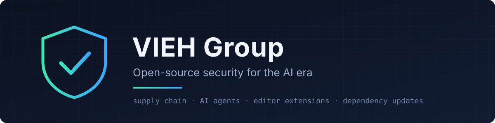

<p align="center">
  
</p>

**VIEH Group** builds free, open-source security tools. Our current focus is the new attack
surface that AI and modern development created: coding agents, hidden prompts, package
registries, editor extensions and dependency updates.

Every tool is MIT-licensed, has no dependencies, and is tested against real-world attacks and real packages.

## 🛡️ Security tools

| Tool | What it stops |
|---|---|
| **[ghostwatch](https://github.com/viehgroup/ghostwatch)** | Hidden instructions for AI. Finds text people can't see but AI reads (white-on-white, tiny fonts, invisible PDF layers) in documents, web pages and GitHub issues, and flags agent workflows a stranger could hijack. |
| **[bumpwatch](https://github.com/viehgroup/bumpwatch)** | Hijacked package updates. Compares each release with the one it replaces and flags new install scripts, startup hooks, hidden code and missing provenance, right on the Dependabot pull request. |
| **[extwatch](https://github.com/viehgroup/extwatch)** | Backdoored VS Code, Cursor and Windsurf extensions. Checks what extensions do, compares them with the official release, and hunts for leftovers. |
| **[agentscan](https://github.com/viehgroup/agentscan)** | Leaked keys, risky permissions and hidden instructions in AI agent configs for Claude Code, Cursor, Copilot, Windsurf, Gemini CLI and MCP. |
| **[slopwatch](https://github.com/viehgroup/slopwatch)** | Hallucinated and typosquatted packages. Blocks names an AI made up before `pip` or `npm` installs them. |

Try one in a minute:

```
pip install git+https://github.com/viehgroup/bumpwatch
bumpwatch inspect npm axios 1.14.1
```

## 🔍 Earlier projects

| Project | About |
|---|---|
| [Information-Gathering](https://github.com/viehgroup/Information-Gathering) | Reconnaissance toolkit for ethical hacking |
| [NetWatch](https://github.com/viehgroup/NetWatch) | Real-time network monitoring with email alerts |
| [The_Scripter](https://github.com/viehgroup/The_Scripter) | Automation scripts that make pentesting easier |
| [hybrid-encryption](https://github.com/viehgroup/hybrid-encryption) | File protection with hybrid encryption |

## 🌐 Connect

Website: [viehgroup.com](https://www.viehgroup.com)

Found a bug or have an idea? Open an issue on any repository. Contributions are welcome.
